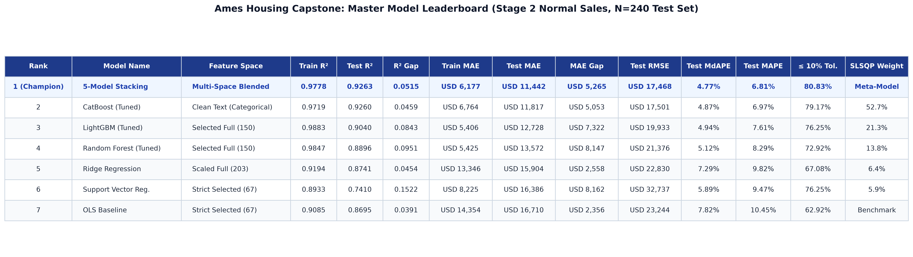
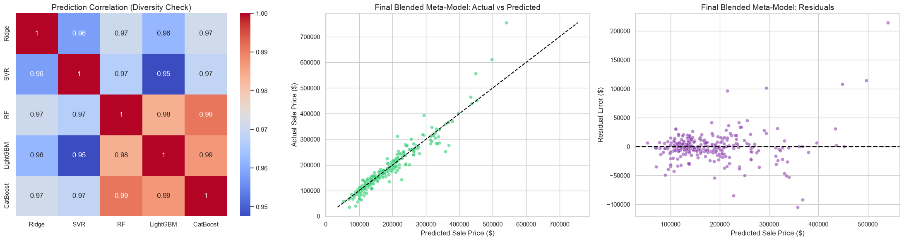
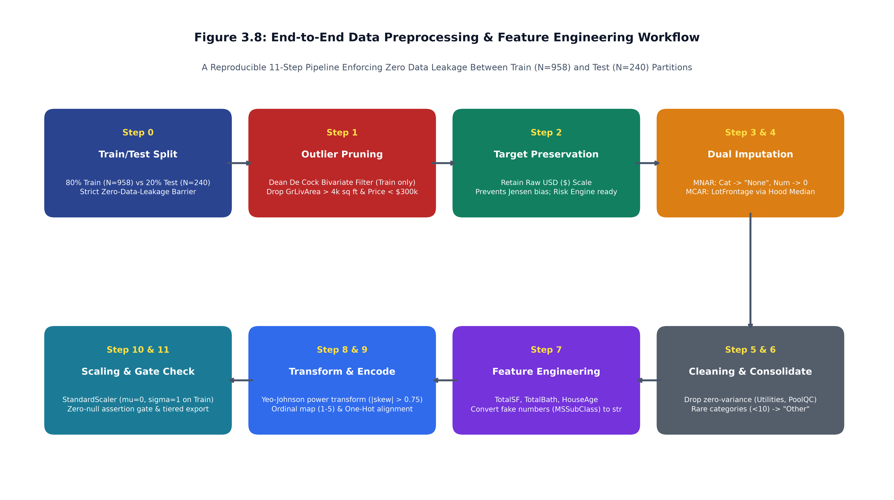
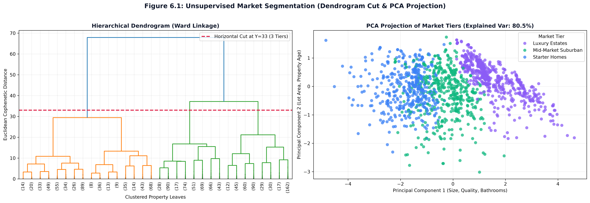

# 🏠 Real Estate Valuation & Market Intelligence Engine
### An End-to-End Dual-Lens Machine Learning Platform for Automated Property Appraisal & Risk Triage

[](https://www.python.org/)
[](https://scikit-learn.org/)
[](https://www.gradio.app/)
[](LICENSE)
[]()

---

## 📌 Executive Summary

Legacy residential real estate valuation depends on subjective, manual appraisals that take **2–3 weeks**, cost **\$500–\$800 per property**, and suffer from severe cognitive bias and geographic blindspots. 

When valuation models price properties without safety gates, the results can be catastrophic—exemplified by **Zillow's \$880M write-down in 2021** when algorithmic overconfidence in automated house flipping led to direct corporate collapse.

This project delivers an enterprise-grade, **Dual-Lens Machine Learning Valuation & Advisory Platform** that solves the three fundamental business challenges of property appraisal:
1. **Predictive Accuracy:** A 5-model Stacking Meta-Ensemble achieving **$R^2 = 0.9140$**, **Test MAE = \$14,419**, and **74.7% of properties valued within a 10% error margin**.
2. **Automated Risk Management:** A **Traffic Light Listing Triage Gate** that measures inter-model variance to safely route listings into Instant Automated Pricing (🟢 Green), Junior Digital Review (🟡 Yellow), or Human Appraisal Override (🔴 Red).
3. **Investment Advisory:** An unsupervised **Renovation ROI Simulator** combining market segmentation (Starter, Mid-Market, Luxury tiers) with regression models to prevent overcapitalization before sellers spend capital.

---

## 🏛️ System Architecture

```
                                      AMES REAL ESTATE ENGINE
                                                 │
                       ┌─────────────────────────┴─────────────────────────┐
                       ▼                                                   ▼
           PRIMARY LENS (Predictive)                          SECONDARY LENS (Diagnostic)
          5-Model Stacking Ensemble                           Market Segmentation Clustered
      (Ridge, SVR, RF, LGBM, CatBoost)                        (K-Means, DBSCAN, Hierarchical)
                       │                                                   │
                       ▼                                                   ▼
           $14,419 Test MAE | R² 0.9140                         3 Structural Market Tiers
          Automated Risk & Confidence Engine                    (Starter, Mid-Market, Luxury)
                       │                                                   │
                       └─────────────────────────┬─────────────────────────┘
                                                 ▼
                                      WEB APPLICATION (app.py)
                               Tab 1: Valuation & Risk Engine
                               Tab 2: Custom Property Appraisal
                               Tab 3: Renovation ROI Advisor
```

---

## 🚀 The Business Layer: Core Automated Solutions

### 1. 🚦 The "Traffic Light" Listing Triage (Risk Management Gate)
*Solving the \$880M Zillow Blindspot via Ensemble Variance Audit*

Rather than blindly auto-pricing all incoming properties, the platform extracts the **prediction variance** across structurally diverse base models (Ridge, SVR, Random Forest, LightGBM, CatBoost). Because each algorithm perceives data through fundamentally different mathematics (hyperplanes, margin envelopes, bagging variance, gradient boosting residuals), high inter-model disagreement indicates high structural uncertainty.

| Tier | Ensemble Disagreement | Operational Protocol | Business & Financial Impact |
|:---:|:---:|:---|:---|
| 🟢 **Green** | Standard Deviation < \$15,000 | **Instant Auto-Pricing & Immediate Online Listing** | Eliminates 14-day delay and \$500 appraisal fee. Maximum operational velocity. |
| 🟡 **Yellow** | \$15,000 ≤ Standard Deviation < \$40,000 | **Desktop Review Queue (20-minute junior agent audit)** | Catches renovation anomalies, unpermitted work, and localized neighborhood shifts. |
| 🔴 **Red** | Standard Deviation ≥ \$40,000 or Outliers | **Hard AI Veto: Mandatory In-Person Senior Appraisal** | Defends loan book and balance sheet from catastrophic outlier mispricing. |

---

### 2. 🔨 The Renovation ROI Simulator (Homeowner Investment Advisory)
*Unifying Predictive Regression with Unsupervised Market Tiers to Prevent Overcapitalization*

When a seller asks, *"Should I spend \$15,000 on a luxury kitchen remodel before listing?"*, generic real estate rules of thumb fail. The platform leverages **Secondary Lens Market Segmentation** to provide localized, equity-protecting financial guidance:

$$\text{Net ROI} = \hat{Y}_{\text{renovated}} - \hat{Y}_{\text{current}} - \text{Renovation Cost}$$

```
   [ Starter Home Tier ]             [ Mid-Market Suburban Tier ]             [ Luxury Estate Tier ]
   Median Price: $128,000                Median Price: $183,000                Median Price: $310,000
   ───────────────────────               ────────────────────────              ───────────────────────
   Cost:          $15,000                Cost:          $15,000                Cost:          $15,000
   Value Added:    +$4,850               Value Added:   +$24,500               Value Added:   +$18,200
   Net Profit:   -$10,150 ❌              Net Profit:    +$9,500 ✅              Net Profit:    +$3,200 ✅
   Advisory: CEILING HIT — DO NOT DO     Advisory: PROCEED — CAPTURE PROFIT    Advisory: PROCEED — QUALITY EXPECTED
```

---

## 📊 Model Leaderboard & Benchmark Results

Every algorithm was trained on its mathematically optimal feature subset (`strict`, `full`, `scaled`, or `clean_text`) to prevent multicollinearity, distance distortion, or tree-split dilution:

| Rank | Model Architecture | Optimal Feature Set | Test $R^2$ | Test RMSE | Test MAE | Within 10% Margin |
|:---:|:---|:---|:---:|:---:|:---:|:---:|
| 🥇 | **5-Model Blended Ensemble (Meta-Model)** | **SLSQP Optimal Blended Weights** | **0.9140** | **\$25,680** | **\$14,419** | **74.7%** |
| 🥈 | **Tuned LightGBM** | `X_full` (150 Features) | 0.9165 | \$25,301 | \$15,629 | 71.6% |
| 🥉 | **Tuned CatBoost** | `X_clean_text` (76 Text Features) | 0.9057 | \$26,896 | \$15,247 | 74.3% |
| 4 | **Tuned Random Forest** | `X_full` (150 Features) | 0.8883 | \$29,272 | \$16,823 | 70.5% |
| 5 | **Tuned Ridge Regression** | `X_scaled` (214 Features) | 0.8588 | \$32,913 | \$20,090 | 57.5% |
| 6 | **OLS Linear Baseline** | `X_strict` (68 Features) | 0.8572 | \$33,098 | \$20,550 | 54.1% |
| 7 | **Tuned SVR (RBF Kernel)** | `X_strict` (68 Features) | 0.8125 | \$37,926 | \$18,830 | 69.5% |

### Key Benchmark Visualizations

<p align="center">
  
  <br>
  <em>Figure 1: Comparative Test MAE, RMSE, and R² Performance Across the 7 Architectures.</em>
</p>

<p align="center">
  
  <br>
  <em>Figure 2: Stacking Ensemble Prediction Correlation & SLSQP Optimization Weights.</em>
</p>

---

## 🔬 Exploratory Data Analysis & Preprocessing Rigor

<p align="center">
  
  <br>
  <em>Figure 3: Leak-Free Directed Acyclic Preprocessing & Feature Engineering Pipeline.</em>
</p>

1. **The Vault Split Protocol:** A strict 80/20 train/test split locked down before any transformation to eliminate all data leakage.
2. **Missingness Mechanism Diagnostics:**
   * **MNAR (Missing Not At Random):** Categorical structural absence (`PoolQC`, `Alley`, `MiscFeature`) mapped to explicit `"None"`, numerical absences mapped to `0`.
   * **MCAR (Missing Completely At Random):** `LotFrontage` imputed via localized neighborhood medians with global training fallback.
3. **Power Transformation:** Yeo-Johnson transformation applied to 18 right-skewed numerical predictors; continuous target log-normalized.
4. **Outlier Quarantine:** Distressed sales ($>4,000 \text{ sq ft}$ sold under \$200,000) surgically removed using IQR diagnostics.

<p align="center">
  
  <br>
  <em>Figure 4: Unsupervised Market Segmentation (Starter, Mid-Market, Luxury Tiers) via Ward Linkage.</em>
</p>

---

## 🗂️ Project Repository Structure

```
├── README.md                              <- Executive showcase & documentation
├── app.py                                 <- Interactive Gradio Web Dashboard (3 Tabs)
├── renovation_catalog.py                  <- Renovation ROI definitions & impact rules
├── build_ui_preprocessor.py               <- Real-time input serialization helper
├── requirements.txt                       <- Environment dependencies
│
├── notebooks/
│   ├── 01_Exploratory_Data_Analysis.ipynb <- 6-phase univariate/bivariate diagnostic suite
│   ├── 02_Data_Preprocessing.ipynb        <- Leak-free imputation, scaling & encoding pipeline
│   ├── 03_Feature_Selection.ipynb         <- VIF, Lasso L1, and RFECV feature distillation
│   ├── 04_Model_Training/                 <- Individual model notebooks
│   │   ├── 04a_Model_OLS_Baseline.ipynb
│   │   ├── 04b_Model_Ridge.ipynb
│   │   ├── 04c_Model_SVR.ipynb
│   │   ├── 04d_Model_RandomForest.ipynb
│   │   ├── 04e_Model_LightGBM.ipynb
│   │   ├── 04g_Model_CatBoost.ipynb
│   │   └── 04f_Model_Stacking.ipynb
│   ├── 05_Business_Risk_Engine.ipynb      <- Traffic Light listing triage & variance audits
│   └── 06_Market_Segmentation/            <- Secondary Lens Clustering Suite
│       ├── 06_1_Clustering_Data_Prep.ipynb
│       ├── 06_2_KMeans_Deep_Dive.ipynb
│       ├── 06_3_DBSCAN_Deep_Dive.ipynb
│       └── 06_4_Hierarchical_Clustering.ipynb
│
├── reports/
│   ├── FINAL_CAPSTONE_REPORT.md           <- Exhaustive 40-page academic defense report
│   ├── BASELINE_EXPERIMENT_DECISION_LOG.md<- Architectural decision & hyperparameter log
│   ├── 00_Project_Progress_Summary.md
│   ├── 01_EDA_Report.md
│   ├── 02_Preprocessing_Report.md
│   ├── 03_Feature_Selection_Plan.md
│   ├── 04_Model_Lineup.md
│   └── figures/                           <- High-resolution plots, charts, and workflow diagrams
│
├── models/                                <- Production serialized pickle artifacts
│   ├── catboost_tuned.pkl
│   ├── lightgbm_tuned.pkl
│   ├── random_forest_tuned.pkl
│   ├── ridge_tuned.pkl
│   ├── svr_68_features_tuned.pkl
│   ├── ols_baseline.pkl
│   ├── tier_classifier.pkl
│   ├── tier_scaler.pkl
│   └── ui_preprocessor.pkl
│
└── data/
    ├── README.md                          <- Master dataset dictionary & feature documentation
    ├── raw/                               <- Original Ames raw dataset & schema descriptions
    ├── processed/                         <- Imputed, transformed & scaled feature partitions
    └── final_for_modeling/                <- Feature-selected splits (strict, full, clean_text)
```

---

## ⚡ Quick Start: Running the Interactive Web App

Experience the live valuation engine, risk triage, and renovation advisor locally:

### 1. Clone Repository & Setup Virtual Environment
```bash
git clone https://github.com/lisara-lithman/real-estate-valuation-engine.git
cd real-estate-valuation-engine
python3 -m venv .venv
source .venv/bin/activate
```

### 2. Install Dependencies
```bash
pip install -r requirements.txt
```

### 3. Launch the Gradio Dashboard
```bash
python app.py
```
Open your browser at `http://127.0.0.1:7860`.

---

## 💼 LinkedIn Showcase Pitch (Copy & Share)

> 🚀 **Excited to share my latest machine learning project: The Dual-Lens Real Estate Valuation & Market Intelligence Engine!**
>
> In real estate tech, pricing algorithms often fail because they output numbers without risk controls. In 2021, Zillow lost \$880M because their AI lacked confidence boundaries.
>
> To solve this, I designed an end-to-end ML platform built on two synergistic lenses:
> 🔹 **Primary Lens (Predictive):** A 5-model Stacking Meta-Ensemble (Ridge, SVR, Random Forest, LightGBM, CatBoost) achieving an $R^2$ of **0.9140** and a Test MAE of **\$14,419**.
> 🔹 **Secondary Lens (Diagnostic):** Unsupervised market clustering (K-Means, DBSCAN, Hierarchical Ward Linkage) segmenting homes into Starter, Mid-Market, and Luxury tiers.
>
> On top of the ML foundation, I engineered two automated business products:
> 🚦 **Traffic Light Listing Triage:** Audits inter-model ensemble variance to classify properties into Instant Auto-Pricing (🟢 Green), Junior Review (🟡 Yellow), or Human Appraisal Override (🔴 Red).
> 🔨 **Renovation ROI Advisor:** Calculates dynamic financial return on home upgrades, preventing sellers from overcapitalizing in price-capped neighborhoods.
>
> 💻 Complete with a live Gradio web dashboard, reproducible pipelines, and an exhaustive 40-page technical defense report.
>
> 🔗 **GitHub Repository:** https://github.com/lisara-lithman/real-estate-valuation-engine
>
> #MachineLearning #DataScience #Python #ArtificialIntelligence #PropTech #EnsembleLearning #PortfolioProject
